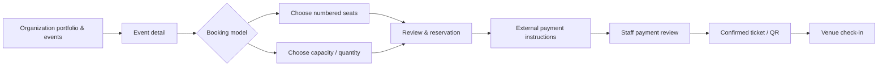
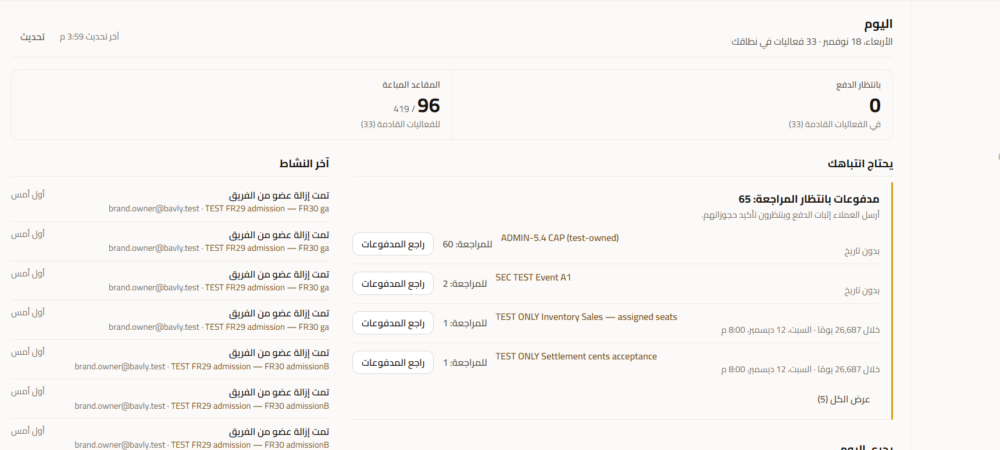
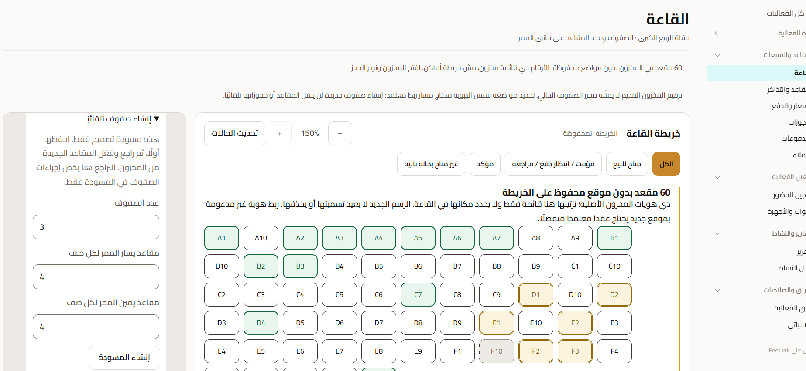
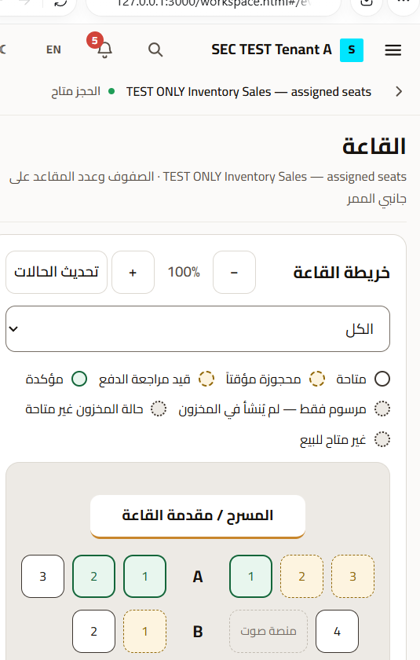
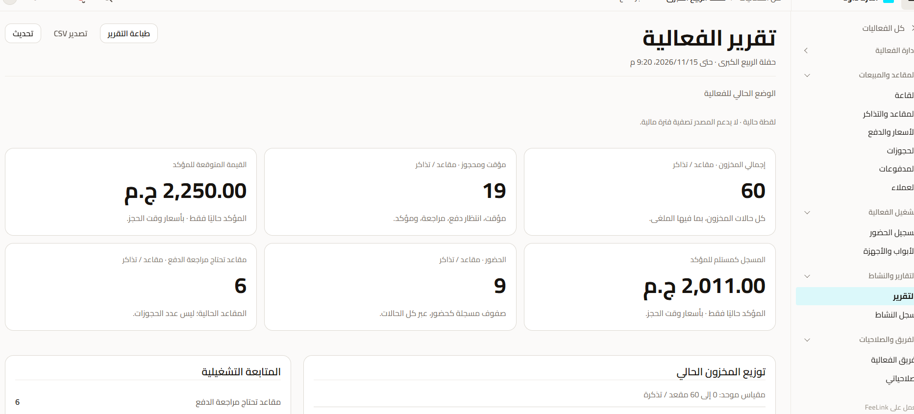
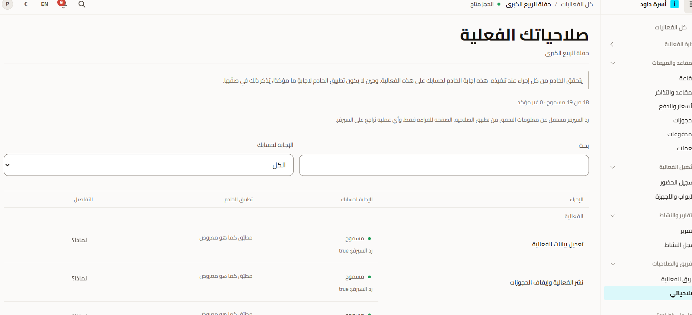

# FeeLink — Organization & Event Management Platform

**Product case study | Business & System Analysis | AI-Assisted Development**  
**Status:** Actively in development · **Portfolio snapshot:** November 2026

FeeLink is an **Arabic-first platform** that brings together two needs that organizations often manage separately: **telling their story online** and **running their events**. It combines an organization-facing portfolio and public event website with an operations workspace for bookings, seating, payment review, tickets, staff access, and reporting.

The first organization experience is for **Da2ood Family**, a community group that organizes concerts, theatre performances, and other activities. The commercial platform itself is a broader product in development—not a finished multi-tenant SaaS product.

> **This is a portfolio case study, not a runnable copy of the commercial application.** Screenshots reflect a local/test environment with test events and values, not live revenue or customer outcomes. The full source code, internal data, and credentials are not public.

## Why I started it

I helped organize events and experienced the limits of managing reservations through spreadsheets and manual messages. I first worked with an **Excel seat-management workflow**, then built an **Excel/VBA booking tool**. FeeLink is my next step: designing a more connected experience for visitors and for the teams responsible for event operations.

**Related project:** [Event Booking Management System — Excel/VBA](https://github.com/Peternab8/Event-Booking-Management-System).

## Two connected experiences

### 1 — Public website & organization portfolio

A public website where visitors can learn about the organization, discover activities, and start an event booking. The product vision also includes showcasing its team, previous work, photos, and history. **Public event discovery and the branded homepage have visible implementation evidence; full portfolio/gallery coverage is still evolving.**

### 2 — Event booking & administration

- **Reserved seating:** visual hall map with named seats, inventory, and different seat states.
- **General admission:** capacity-based admission without numbered seat selection; present in the project's feature implementation and test documentation, with full release readiness still being assessed.
- **Booking and payment:** reservation states and a **manual / out-of-app payment review** workflow. An automatic online payment gateway is **not** claimed.
- **Operations:** event setup and lifecycle, bookings, staff roles, activity records, ticket/check-in workflows, and event reporting—at differing stages of completion and verification.

## How the experience is designed

The business rule behind the flow is simple: **a reservation is not described as paid or confirmed until the server has verified the required state transition**. This protects both visitor expectations and event operations. See [Product decisions & workflows](docs/DECISIONS_AND_WORKFLOWS.md).

## Selected screens

| Public / operations | What the screenshot demonstrates |
| --- | --- |
|  | A daily operations workspace for staff, activity, and attention items (test data). |
|  | Hall inventory, named seats, and state-based visualization on desktop (test environment). |
|  | A narrow-screen version of the hall workspace. |
|  | Booking, seat, attendance, and payment indicators (test fixtures; **not live results**). |
|  | Visibility of event-level permissions and server-side authorization decisions. |

> Screenshots are **illustrative**, not proof that every end-to-end scenario or production security control is complete. See the [feature evidence and status matrix](docs/FEATURE_STATUS.md).

## My contribution

**Product direction, business-process analysis, requirements, hands-on verification, and AI-assisted implementation.**

I identified the operational problem, defined the product direction and user journeys, worked through booking and staff workflows, prioritized features, reviewed test scenarios, and iterated on the implementation. I have been using **Codex and Claude Code** throughout development to generate and refine code. **I do not claim to have written the entire codebase manually.**

What this project demonstrates about my work:

- Translating real-world operational pain points into product requirements.
- Modeling user roles, permissions, booking states, and exceptions.
- Connecting user experience, database constraints, and business rules.
- Reviewing generated implementations and making iterative product decisions.
- Learning to manage a growing technical project while keeping unfinished work clearly labeled.

## Technical environment

**Frontend:** HTML, CSS, Vanilla JavaScript (ES Modules)  
**Backend / data:** Supabase, PostgreSQL, Auth, Realtime, SQL migrations, RLS, server-side functions  
**Tooling:** Node.js scripts, test suites, technical documentation, Codex, Claude Code

These tools are identified from the private project files. Their inclusion here **does not** mean the complete system has passed production certification.

## Delivery status

| Area | Snapshot |
| --- | --- |
| Branded public homepage and event discovery | **Visible / implemented areas**; broader organization portfolio still evolving |
| Reserved-seat booking and hall management | **Visible test UI + source/docs evidence** |
| General admission / capacity-based model | **Implementation / test evidence**, not independently end-to-end verified for this portfolio |
| Event reports, activity log, staff/permission views | **Visible test UI + supporting documentation** |
| Payment review, QR ticketing, check-in | **Source/documentation evidence**; separate release verification required |
| Multi-organization SaaS isolation | **Incomplete / not claimed as production-ready** |
| Fully automatic in-app payments | **Not implemented as a public claim** |

**Project stage: Work in progress.** This matrix is intentionally conservative: existing UI and prior test records are not the same as a fresh production audit.

## Privacy, ownership, and source availability

FeeLink is being developed as a potential commercial product. The full private repository, environment configuration, internal operational documents, database dumps, and customer information are **not included here**. Any screenshots or brand assets are shared only with appropriate permission.

---

**Created and directed by Peter Nabil**  
[GitHub Profile](https://github.com/Peternab8) · [LinkedIn](https://www.linkedin.com/in/peter-nabilg/)
